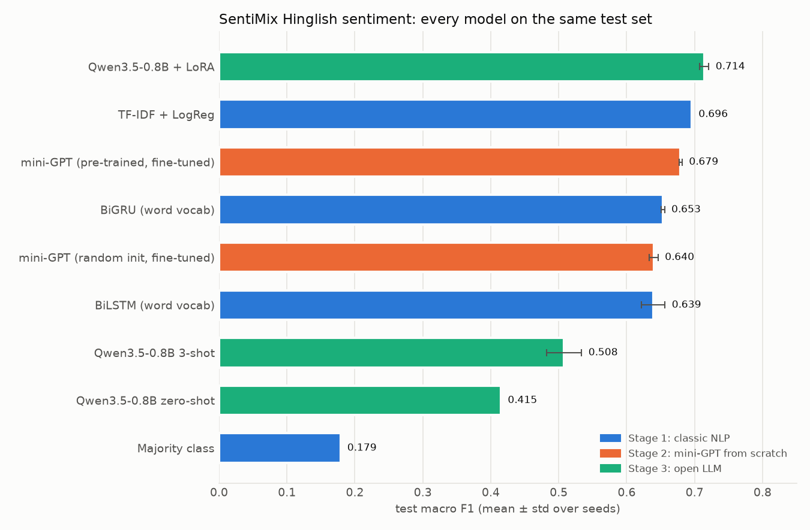
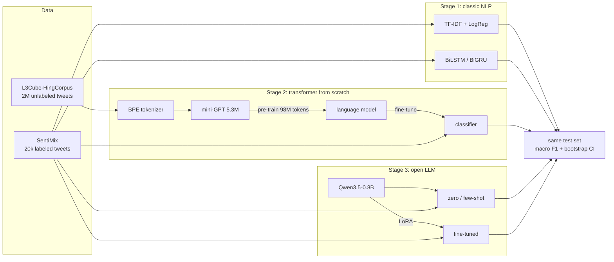
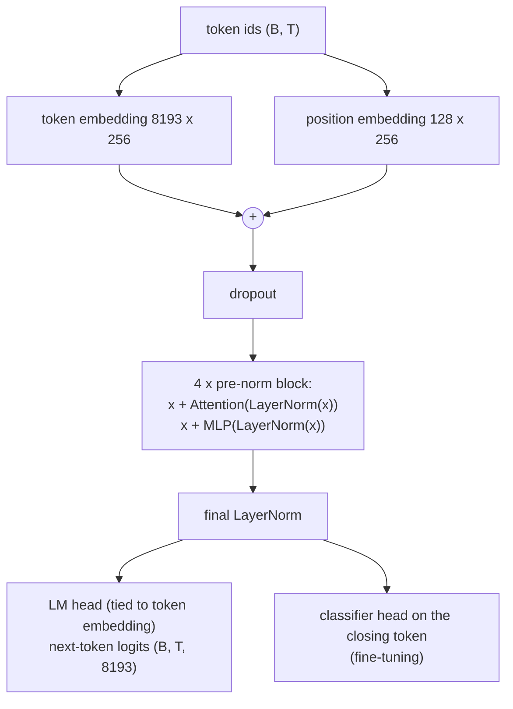
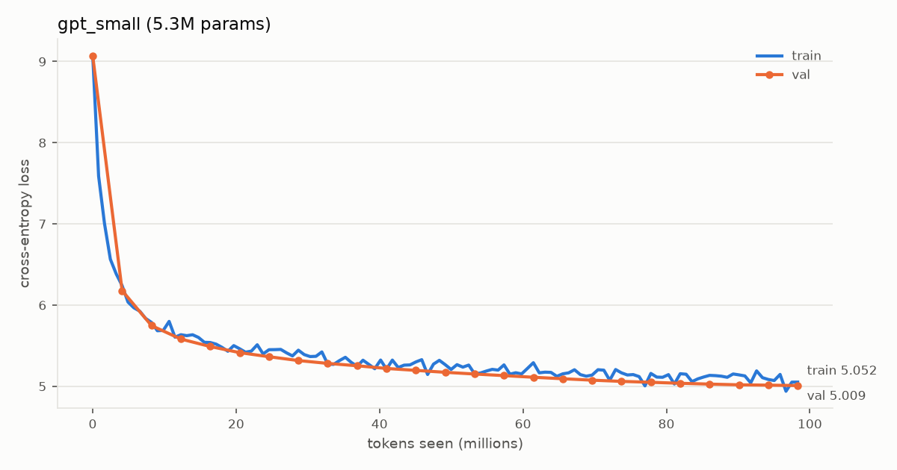

# mini-gpt: a Hinglish GPT from scratch vs a LoRA-tuned open LLM

A GPT written from scratch in PyTorch (BPE tokenizer, attention, transformer blocks, training loop),
pre-trained on 98M tokens of Hinglish (Hindi-English code-mixed) tweets, and compared with classic
NLP baselines and with **Qwen3.5-0.8B** (zero-shot, few-shot, LoRA) on the same sentiment test set.

**Project page with results and a prediction explorer:**
[huggingface.co/spaces/Yash230901/mini-gpt-hinglish](https://huggingface.co/spaces/Yash230901/mini-gpt-hinglish)



## Results

SemEval-2020 Task 9 SentiMix (Hinglish), official test split of 3,000 tweets, 3 classes
(negative / neutral / positive). Macro F1 = mean of per-class F1, so ignoring a class is punished.
Mean ± std over 3 seeds; 95% CI from a paired bootstrap (2,000 resamples) of the median-seed run.

| Model | Params (trained) | Test macro F1 | 95% CI |
|---|---|---|---|
| **Qwen3.5-0.8B + LoRA** (r=16, all linear layers) | 0.75B (10.8M) | **0.714 ± 0.007** | [0.699, 0.730] |
| TF-IDF (word + char n-grams) + logistic regression | 0.3M | 0.696 | [0.680, 0.712] |
| **mini-GPT, pre-trained + fine-tuned** (this repo, from scratch) | 5.3M | 0.679 ± 0.002 | [0.663, 0.696] |
| BiGRU, word vocabulary | 1.8M | 0.653 ± 0.002 | |
| mini-GPT, random init + fine-tuned | 5.3M | 0.640 ± 0.006 | |
| BiLSTM, word vocabulary | 1.9M | 0.639 ± 0.017 | |
| Qwen3.5-0.8B, 3-shot prompt | 0.75B (0) | 0.508 ± 0.026 | [0.490, 0.522] |
| Qwen3.5-0.8B, zero-shot | 0.75B (0) | 0.415 | |
| Majority class | - | 0.179 | |

**Findings**

- **Pre-training works:** the same 5.3M-parameter model gains **+3.9 macro F1** from 40 minutes of
  next-token pre-training on unlabeled Hinglish tweets (0.640 → 0.679).
- **Task labels beat size:** without fine-tuning, the 0.75B LLM scores far below the 5.3M model
  (0.415 zero-shot, 0.508 few-shot). It almost never answers "neutral" (0-8% of predictions vs
  37% of tweets). LoRA fixes that and gives the best model.
- **Differences are small at the top:** LoRA beats TF-IDF by +0.018 (95% CI [+0.002, +0.035]);
  TF-IDF vs the mini-GPT (+0.015, CI [-0.001, +0.032]) is not significant. Character n-grams are
  a strong baseline for short, noisy, code-mixed text.
- **The attention heads are interpretable:** layer 2 head 3 is a previous-token head (57% of its
  weight on token i-1); layer-0 heads use the first token as an attention sink.

Full tables, per-class F1, example predictions and generation samples:
[results/stage3/comparison.md](results/stage3/comparison.md). Every run is logged in
[results/experiments.md](results/experiments.md).

## What's inside



**The mini-GPT** (written from scratch, `src/minigpt/`):



| Piece | File | Notes |
|---|---|---|
| Byte-level BPE tokenizer | [tokenizer/bpe.py](src/minigpt/tokenizer/bpe.py) | 8,192 tokens learned from 50k tweets; 3.74 bytes/token; never `<unk>` |
| Multi-head causal self-attention | [model/attention.py](src/minigpt/model/attention.py) | matches `F.scaled_dot_product_attention` in tests |
| Pre-norm transformer block | [model/block.py](src/minigpt/model/block.py) | residual stream, GELU MLP |
| GPT | [model/gpt.py](src/minigpt/model/gpt.py) | weight tying, GPT-2 init (scaled residual projections) |
| Training loop | [train.py](src/minigpt/train.py) | AdamW, warmup + cosine, grad clipping, checkpoint/resume |
| Generation | [generate.py](src/minigpt/generate.py) | greedy, temperature, top-k, top-p |
| LoRA fine-tuning | [lora.py](src/minigpt/lora.py) | reuses the same `train_step` / `get_lr` as pre-training |

Pre-training run: 12,000 steps × 8,192 tokens (98M tokens, ~1.8 epochs), 40 minutes on a GTX 1650
(4 GB). Validation perplexity 8,659 → 150. Sample: *"modi ji ne kaha tha ki bjp ka koi fayda nahi
hai, ab kya hai?"*



## What didn't work (and what it taught)

- **Word-level RNNs** overfit within 3 epochs and lost to TF-IDF: 10.5% of validation words were
  out of vocabulary. Subword tokenization and pre-training address exactly this.
- **Fine-tuning the mini-GPT for 8 epochs** overfit after epoch 1 while the learning rate was still
  near its peak. Short runs (3 epochs) with the schedule decaying over the whole run: +0.9 F1.
- **Contextual calibration** (Zhao et al., 2021) made few-shot Qwen worse. Its content-free inputs
  ("N/A") are genuinely *neutral*, so dividing out that "bias" removed the neutral class even more.
  The method assumes content-free input should be uniform; that fails for tasks with a neutral class.
- **fp16 mixed precision was 4.6× slower than fp32** on the GTX 1650 (no tensor cores), so local
  runs use fp32. The default fp16 loss scale (2^16) also overflowed for Qwen3.5 LoRA.
- **Hyperparameters at the edge of the search grid**, three times: TF-IDF's C, and the fine-tuning
  learning rate twice. Extending the grid changed or confirmed the result each time.
- **Limitation:** the LoRA run's chosen learning rate (1e-4) and best epoch (2 of 2) are both at
  the edge of what was searched, so the LoRA number may be slightly under-tuned.

## Reproduce

Requirements: Python 3.12, a CUDA GPU with ≥4 GB for Stage 2 (CPU works with `gpt_debug.yaml`),
and a Kaggle T4 (free) for the LoRA runs. Paths and caches are configured in `.env`.

```powershell
pip install torch --index-url https://download.pytorch.org/whl/cu128
pip install -r requirements.txt
pip install -e .
copy .env.example .env          # edit the cache paths
pytest                          # 148 tests
```

| Step | Command | Time (GTX 1650) |
|---|---|---|
| Data: SentiMix + 2M-line HingCorpus slice | `python -m minigpt.data --prepare` then `--report` | ~3 min (+2.5 GB download) |
| Stage 1 baselines | `python -m minigpt.train_baseline --config configs/stage1_{tfidf,lstm,gru}.yaml` | 30 s / 2 min each |
| BPE tokenizer + encode corpus | `python -m minigpt.train_tokenizer --encode` | 31 min (pure Python) |
| Pre-train the mini-GPT | `python -m minigpt.train --config configs/gpt_small.yaml` | 40 min |
| Generate / attention maps | `python -m minigpt.generate --demo`, `python -m minigpt.visualize` | 1 min |
| Fine-tune (pre-trained, random init) | `python -m minigpt.finetune --config configs/finetune_{pretrained,scratch}.yaml` | ~7 min each |
| Qwen3.5 zero/few-shot | `python -m minigpt.llm` | ~1 h |
| Qwen3.5 LoRA | [notebooks/kaggle_lora_qwen35.ipynb](notebooks/kaggle_lora_qwen35.ipynb) on a Kaggle T4 | ~4 h |
| Final comparison | `python -m minigpt.compare` | ~15 min |
| Demo app (local) | `python -m minigpt.export_app` then `python app/app.py` | |
| Project page | `python -m minigpt.build_site` → `dist/site/` | |

All hyperparameters live in [`configs/`](configs/); seeds are fixed and results reproduce to
4 decimals on the same hardware.

## Repository layout

```
configs/            YAML config for every run
src/minigpt/        package: data, tokenizers, models, training, evaluation, LLM, app export
tests/              148 pytest tests (shapes, causality, references, metrics, exports)
notebooks/          Kaggle notebook for the LoRA runs
app/                Gradio demo (classify with 3 models, generate, attention maps)
artifacts/          trained BPE tokenizer
results/            metrics, plots, experiments log (data/ and checkpoints/ are gitignored)
```

## Data and licenses

- **SentiMix** (SemEval-2020 Task 9, Hinglish), via the
  [RTT1/SentiMix](https://huggingface.co/datasets/RTT1/SentiMix) mirror: research use.
  Test tweets are not redistributed in this repo.
- **L3Cube-HingCorpus** ([repo](https://github.com/l3cube-pune/code-mixed-nlp)):
  CC BY-NC-SA 4.0. The mini-GPT is trained on it, so the model weights and the demo are
  **non-commercial, share-alike**.
- **Qwen3.5-0.8B** ([Qwen/Qwen3.5-0.8B](https://huggingface.co/Qwen/Qwen3.5-0.8B)): Apache-2.0.

References: Patwa et al., *SemEval-2020 Task 9: Overview of Sentiment Analysis of Code-Mixed
Tweets* (2020); Nayak & Joshi, *L3Cube-HingCorpus and HingBERT* (2022); Hu et al., *LoRA* (2021);
Zhao et al., *Calibrate Before Use* (2021); Radford et al., *GPT-2* (2019).
